# LinCa

**Accelerating Diffusion Models via Learnable Decomposed Feature Caching**

<p align="center">
  <a href="https://arxiv.org/abs/2608.17973"></a>
  <a href="https://arxiv.org/abs/2608.17973"></a>
  <a href="https://github.com/QHR69/LinCa"></a>
  <a href="https://huggingface.co/QHRQQQ/LinCa"></a>
  <a href="LICENSE"></a>
  <a href="README_zh.md"></a>
</p>

<p align="center">
<a href="https://arxiv.org/abs/2608.17973">Paper</a> ·
<a href="https://github.com/QHR69/LinCa">Code</a> ·
<a href="https://huggingface.co/QHRQQQ/LinCa">Weights</a> ·
<a href="README_zh.md">中文说明</a>
</p>

<p align="center"><b>Official implementation of the ECCV 2026 paper.</b></p>

LinCa accelerates diffusion inference with a lightweight invertible network. Cached features are **decomposed** into sub-components with different continuity, each is **predicted** with a matching order, then **reconstructed** back to the original space. The mapping is strictly invertible, so reconstruction is lossless.

**&lt;0.2% extra parameters. Up to 7.08× fewer FLOPs. Near-lossless quality.**

<p align="center">
  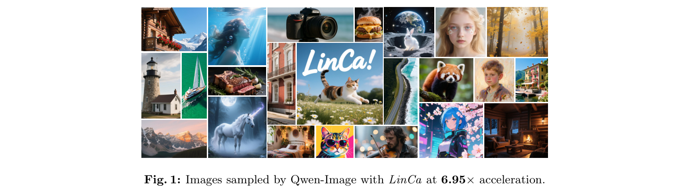
</p>
<p align="center"><em>Fig. 1. Images sampled by Qwen-Image with LinCa at 6.95× acceleration.</em></p>

> **Every speedup in this README is a FLOPs speedup** relative to the original full-step model, taken directly from the paper tables. FLOPs is hardware-independent; measured latency is available in the cropped tables below.

## News

- **2026-08** — **Accepted to ECCV 2026.** Code, paper, and predictor weights are public. FLUX / Qwen-Image / Qwen-Image-Edit predictors are on [Hugging Face](https://huggingface.co/QHRQQQ/LinCa).

## Highlights

Best quality-preserving operating point per model:

| Model | Setting | FLOPs speedup | Quality | vs. original |
|---|---|---:|---|---|
| **FLUX.1-dev** | `N=6` | **4.52×** | ImageReward **1.0228** · CLIP **32.97** | **+3.0%** IR (orig. 0.9930) |
| **FLUX.1-dev** | `N=8` | **5.51×** | ImageReward **1.0162** · CLIP 32.72 | **+2.3%** IR |
| **Qwen-Image** | `N=6` | **4.90×** | ImageReward **1.2163** · CLIP **35.34** · PSNR **29.84** | **−2.9%** IR (orig. 1.2532) |
| **Qwen-Image-Edit** | `N=7` | **5.52×** | GEdit-EN OS **7.56** · CN OS **7.45** | **above** original (7.54 / 7.41) |
| **HunyuanVideo** | `N=6` | **5.50×** | VBench **80.16** | **−0.6%** (orig. 80.66) |
| **Wan2.1-1.3B** | `N=6` | 5.00× ¹ | VBench **82.56** | beats TaylorSeer 81.07 @ 4.17× |

¹ Paper Table 10 reports step-count speedup for Wan2.1; FLOPs were not tabulated in that experiment.

Pushing further: **Qwen-Image at 6.95×** still holds ImageReward 1.0524 and CLIP 35.17, and **Qwen-Image-Edit at 7.08×** still holds GEdit-EN OS 7.40 — ratios where every competing cache collapses.

LinCa also stacks on top of **FLUX.1-lite-8B**, **FLUX.1-schnell**, **FLUX.1-dev-int8**, and **Qwen-Image-Lightning**. Predictors train from 100–200 cached features in about **one hour on a single 12 GB GPU**, without loading the backbone.

## Why existing caches break

Training-free caches apply **one** prediction rule to every model, every timestep, and every feature dimension. Continuity is not uniform: some dimensions jump, some are smooth, and the mix changes across models and denoising stages.

<p align="center">
  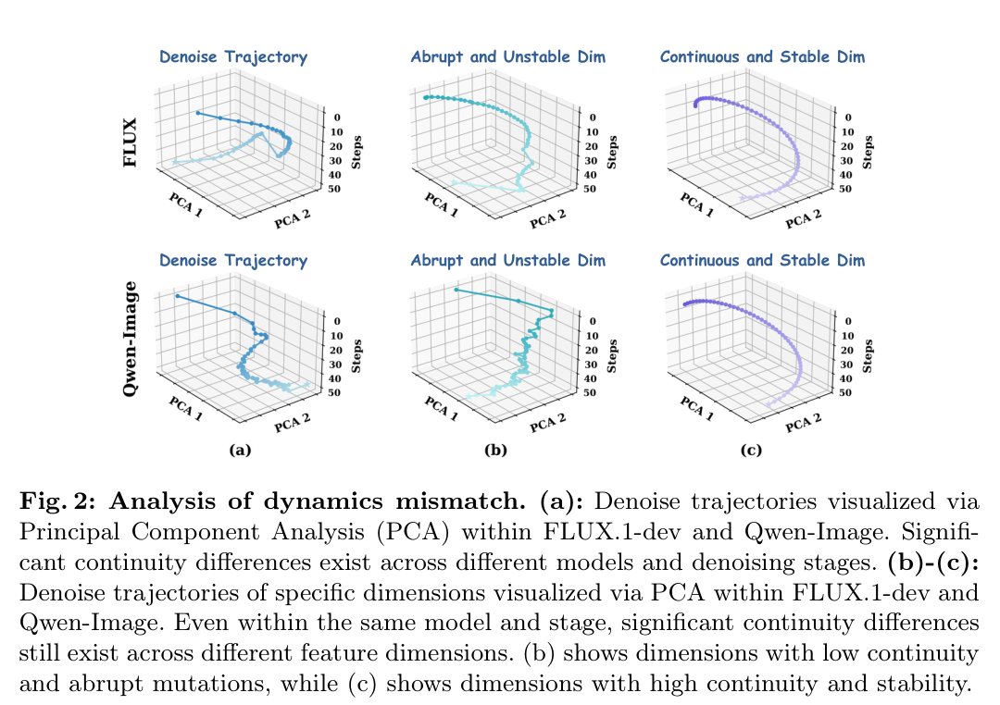
</p>
<p align="center"><em>Fig. 2. Dynamics mismatch across models, stages, and dimensions. (b) unstable dimensions; (c) stable dimensions.</em></p>

## Method

LinCa is a **Decompose → Predict → Reconstruct** pipeline:

1. **Decompose** — a learnable invertible network maps a cached DiT feature into partitions with different continuity.
2. **Predict** — order 0 reuses the last cache; higher-order partitions use matching polynomial prediction.
3. **Reconstruct** — the inverse mapping returns the predicted feature. Each block is an invertible 1×1 convolution plus an additive coupling layer, so the network is exactly invertible and adds no reconstruction error.

Separate predictors are trained per model and per timestep segment, so one framework adapts to heterogeneous feature dynamics at negligible cost.

<p align="center">
  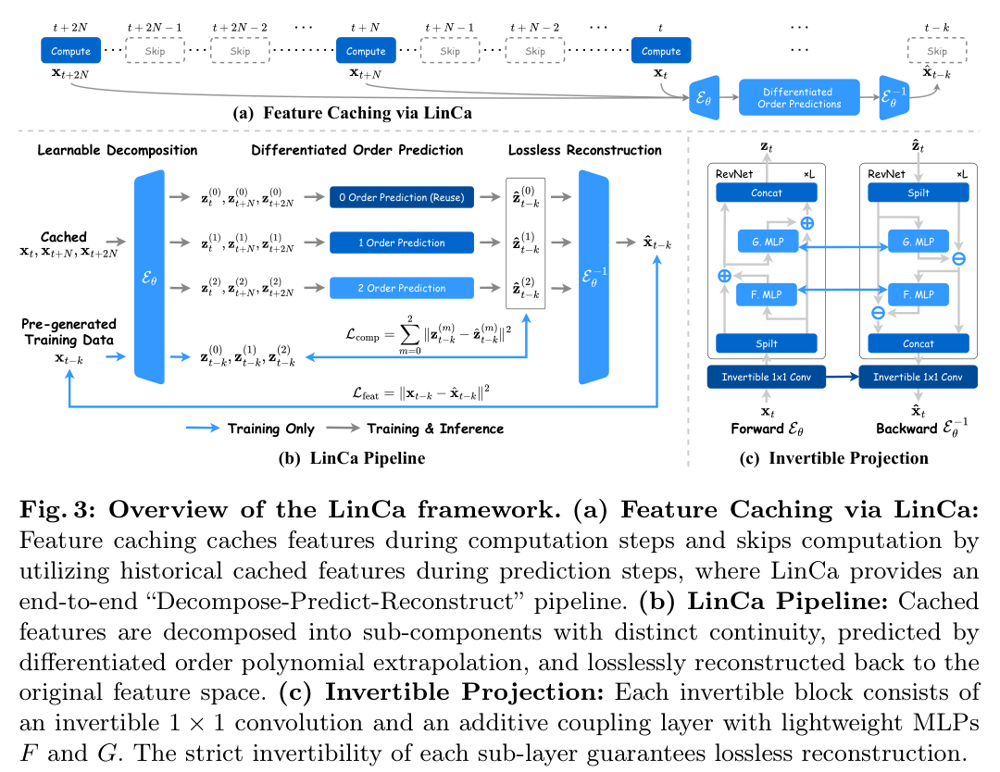
</p>
<p align="center"><em>Fig. 3. Overview of LinCa: feature caching, the decompose–predict–reconstruct pipeline, and the invertible block.</em></p>

## Results

### Text-to-image: FLUX.1-dev

At **4.52× fewer FLOPs**, LinCa *improves* on the 50-step original (+3.0% ImageReward, +1.1% CLIP). Competing caches give up either quality or speed.

| Method | FLOPs speedup | ImageReward ↑ | CLIP ↑ |
|---|---:|---:|---:|
| Original, 50 steps | 1.00× | 0.9930 | 32.61 |
| TaylorSeer `N=4` | 3.84× | 0.9887 | 32.58 |
| DBCache `F=4,B=4` | 4.10× | 0.6372 | 32.10 |
| HyCa `N=5` | 4.16× | 1.0096 | 32.87 |
| TeaCache `l=0.8` | 4.17× | 0.8710 | 31.89 |
| **LinCa `N=6`** | **4.52×** | **1.0228** | **32.97** |
| FORA `N=5` | 4.16× | 0.8276 | 31.95 |
| DuCa `N=7` | 4.89× | 0.9785 | 32.26 |
| HyCa `N=6` | 5.00× | 1.0043 | 32.64 |
| TeaCache `l=1` | 5.01× | 0.8421 | 32.01 |
| **LinCa `N=8`** | **5.51×** | **1.0162** | 32.72 |

<p align="center">
  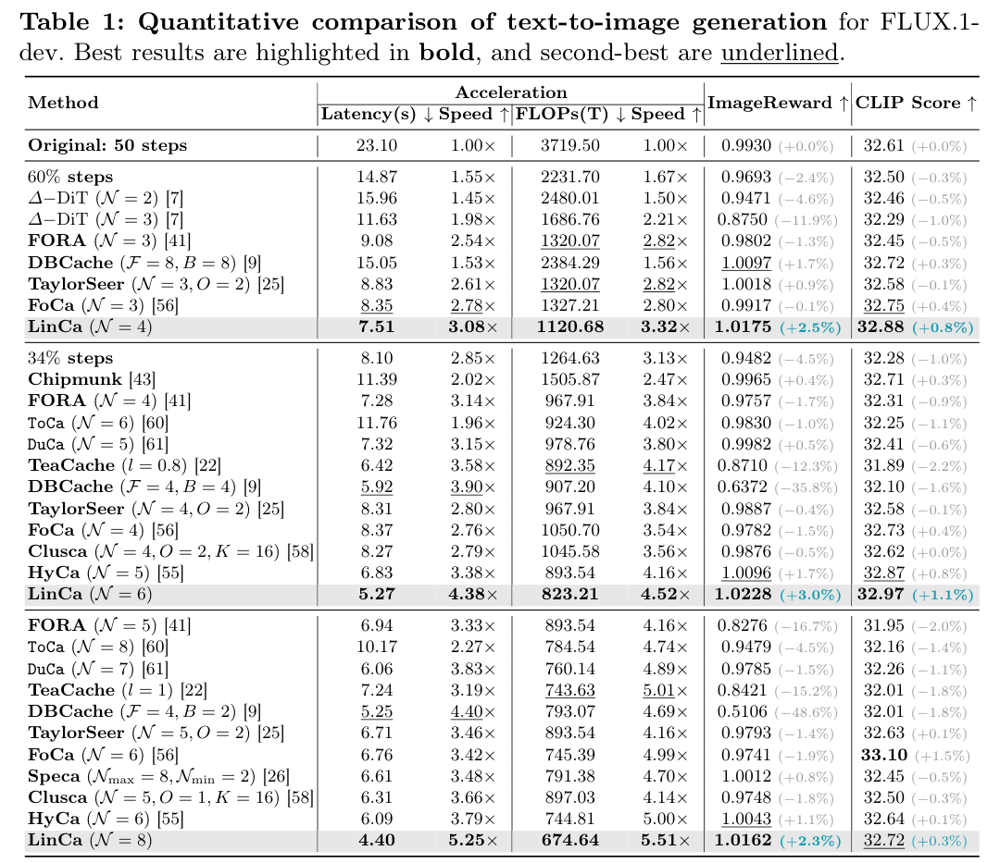
</p>

LinCa is faster *and* keeps rendered text, small details, and spatial relations that other caches drop.

<p align="center">
  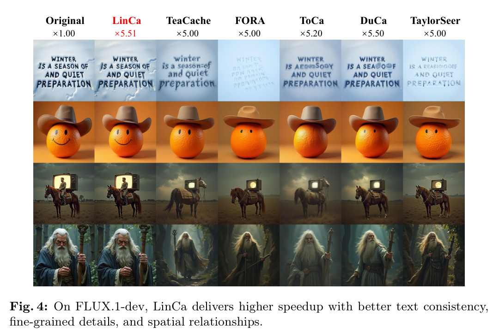
</p>

### Text-to-image: Qwen-Image

The clearest win. At **4.90×**, LinCa loses only **2.9%** ImageReward, while TaylorSeer at a comparable 5.00× loses **19.2%**. LinCa leads on every quality *and* perceptual metric at once.

| Method | FLOPs speedup | ImageReward ↑ | CLIP ↑ | PSNR ↑ | SSIM ↑ | LPIPS ↓ |
|---|---:|---:|---:|---:|---:|---:|
| Original, 50 steps | 1.00× | 1.2532 | 35.52 | ∞ | 1.00 | 0.00 |
| FORA `N=4` | 3.84× | 0.9315 | 34.33 | 28.65 | 0.60 | 0.50 |
| ToCa `N=8, R=75%` | 4.32× | 1.0218 | 34.97 | 28.94 | 0.63 | 0.45 |
| DuCa `N=9, R=80%` | 4.37× | 0.7709 | 34.59 | 28.44 | 0.58 | 0.54 |
| TaylorSeer `N=6` | 5.00× | 1.0125 | 34.77 | 28.59 | 0.62 | 0.45 |
| HyCa `N=6` | 5.00× | 1.1967 | 34.89 | 29.68 | 0.71 | 0.31 |
| **LinCa `N=6`** | **4.90×** | **1.2163** | **35.34** | **29.84** | **0.73** | **0.29** |
| TaylorSeer `N=9` | 6.25× | 0.7318 | 32.89 | 28.24 | 0.56 | 0.57 |
| HyCa `N=8` | 6.25× | 1.0432 | 34.82 | 28.86 | 0.62 | 0.44 |
| **LinCa `N=10`** | **6.95×** | **1.0524** | **35.17** | **29.10** | **0.69** | **0.39** |

<p align="center">
  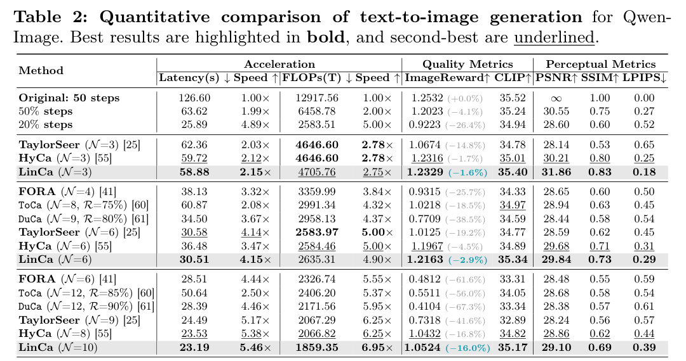
</p>

Quality holds as the acceleration ratio grows; TaylorSeer blurs and loses detail.

<p align="center">
  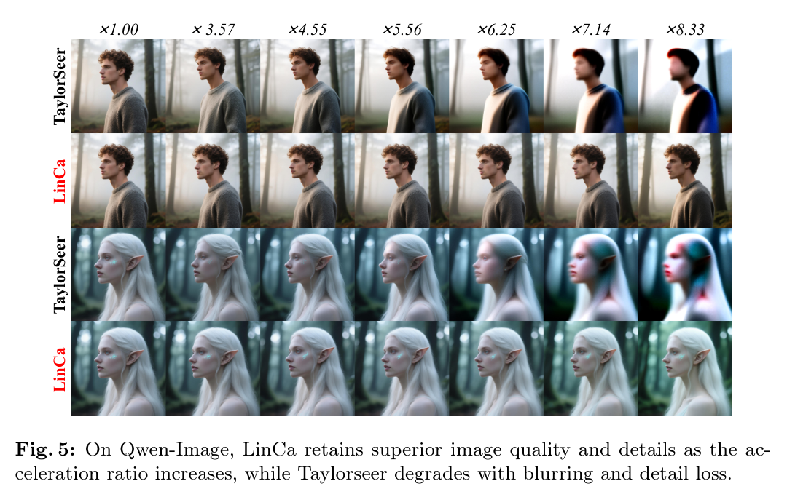
</p>

### Image editing: Qwen-Image-Edit (GEdit-Bench)

At **5.52×**, LinCa **exceeds the original model** on both English and Chinese overall scores. At **7.08×** it still holds 7.40 / 7.27, while DuCa and TaylorSeer fall to about 6.3.

| Method | FLOPs speedup | GEdit-CN OS ↑ | GEdit-EN OS ↑ |
|---|---:|---:|---:|
| Original, 50 steps | 1.00× | 7.41 | 7.54 |
| FORA `N=5` | 5.00× | 7.25 | 7.28 |
| TaylorSeer `N=6` | 5.00× | 6.92 | 6.89 |
| DuCa `N=7, R=95%` | 4.95× | 7.44 | 7.45 |
| **LinCa `N=7`** | **5.52×** | **7.45** | **7.56** |
| DuCa `N=10, R=95%` | 5.46× | 6.39 | 6.41 |
| FORA `N=7` | 6.24× | 7.06 | 7.06 |
| TaylorSeer `N=9` | 6.24× | 6.31 | 6.31 |
| **LinCa `N=10`** | **7.08×** | **7.27** | **7.40** |

<p align="center">
  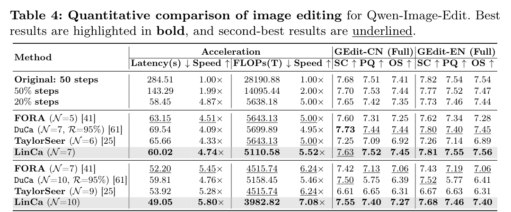
</p>

Instruction following stays sharp and unedited regions stay consistent.

<p align="center">
  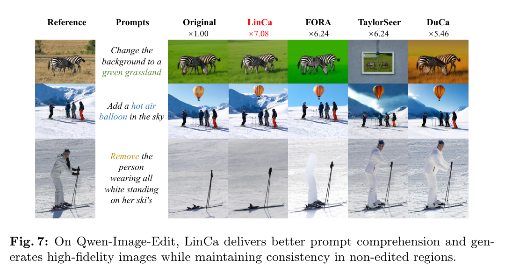
</p>

### Text-to-video: HunyuanVideo

Highest speedup **and** highest VBench score in the comparison — only 0.6% below the 50-step original.

| Method | FLOPs speedup | VBench ↑ |
|---|---:|---:|
| Original, 50 steps | 1.00× | 80.66 |
| ToCa `N=5, R=90%` | 4.25× | 78.86 |
| DuCa `N=5, R=90%` | 4.48× | 78.72 |
| TeaCache `l=0.4` | 4.55× | 79.36 |
| FoCa `N=5` | 4.99× | 79.96 |
| Clusca `N=5, K=32` | 4.99× | 79.99 |
| TaylorSeer `N=5` | 5.00× | 79.93 |
| Speca | 5.23× | 79.98 |
| **LinCa `N=6`** | **5.50×** | **80.16** |

<p align="center">
  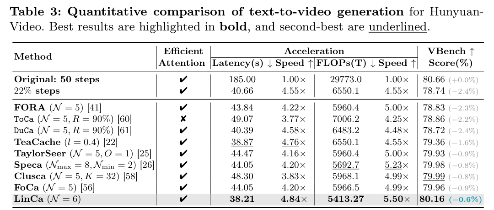
</p>

LinCa keeps background, layout, and motion that 22%-steps / TaylorSeer / TeaCache lose — at a higher speedup.

<p align="center">
  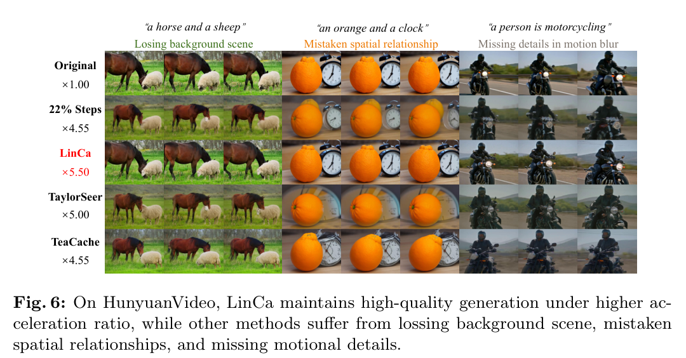
</p>

### Text-to-video: Wan2.1-1.3B

| Method | Steps | Speedup ¹ | VBench ↑ |
|---|---:|---:|---:|
| Original | 50 | 1.00× | 83.72 |
| TaylorSeer `N=5` | 12 | 4.17× | 81.07 |
| **LinCa `N=6`** | 10 | **5.00×** | **82.56** |

<p align="center">
  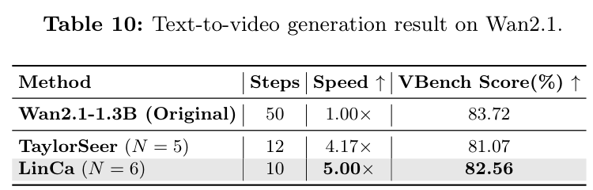
</p>

### Stacking with distillation and quantization

LinCa is complementary to compression: it adds speedup on top of distilled and INT8 backbones **while improving quality**.

| Backbone | Setting | FLOPs speedup | ImageReward ↑ | CLIP ↑ |
|---|---|---:|---:|---:|
| FLUX.1-lite-8B, 28 steps | + LinCa `N=3` | **2.32×** | 0.8936 → **0.9070** | 32.12 → **32.36** |
| FLUX.1-schnell, 4 steps | + LinCa `N=3` | **1.99×** | 0.9692 → **0.9843** | 32.54 → **32.67** |
| FLUX.1-dev-int8, 50 steps | + LinCa `N=3` | **2.63×** | 0.9744 → **1.0036** | 32.55 → **32.81** |

<p align="center">
  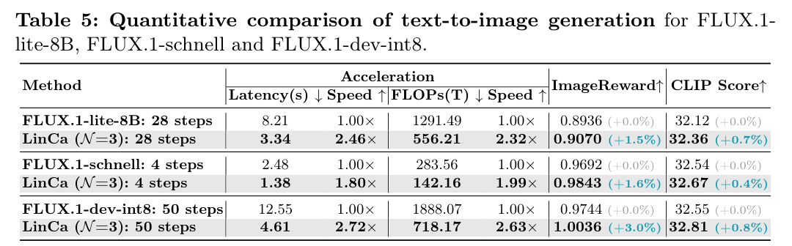
</p>

### Versus distilled models and training-based caches

Paper Tables 7–9 report step-count speedup ¹. On FLUX, LinCa at 14 steps beats FLUX.1-lite-8B at 28 steps on both speed and quality. On Qwen-Image it beats the official distilled checkpoints and LESA at every matched ratio.

| Model | Method | Steps | Speedup ¹ | ImageReward ↑ |
|---|---|---:|---:|---:|
| FLUX.1-dev | Original | 50 | 1.00× | 0.99 |
| FLUX.1-dev | FLUX.1-lite-8B | 28 | 1.79× | 0.89 |
| FLUX.1-dev | **LinCa `N=4`** | 14 | **3.57×** | **1.02** |
| FLUX.1-dev | LESA `N=7` | 9 | 5.56× | 0.98 |
| FLUX.1-dev | **LinCa `N=8`** | 8 | **6.25×** | **1.02** |
| Qwen-Image | Original | 50 | 1.00× | 1.25 |
| Qwen-Image | Qwen-Image-Distill-Full | 15 | 3.33× | 1.02 |
| Qwen-Image | Qwen-Image-Distill-LoRA | 15 | 3.33× | 0.95 |
| Qwen-Image | **LinCa `N=4`** | 14 | **3.57×** | **1.19** |
| Qwen-Image | LESA `N=10` | 7 | 7.14× | 1.01 |
| Qwen-Image | **LinCa `N=10`** | 7 | **7.14×** | **1.05** |

<p align="center">
  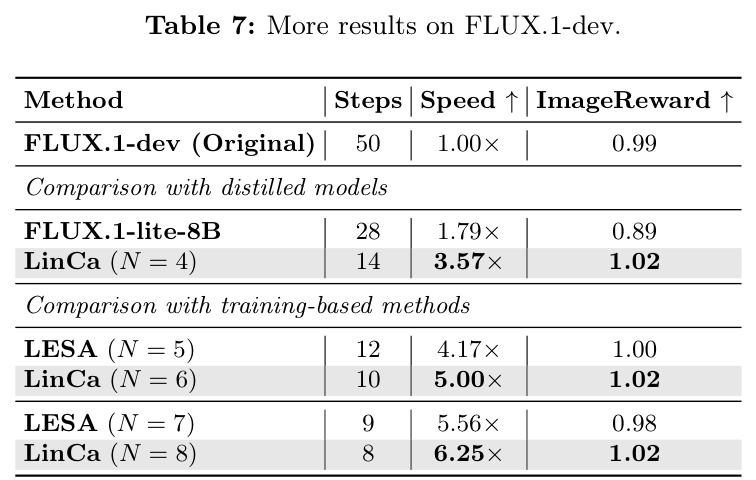
  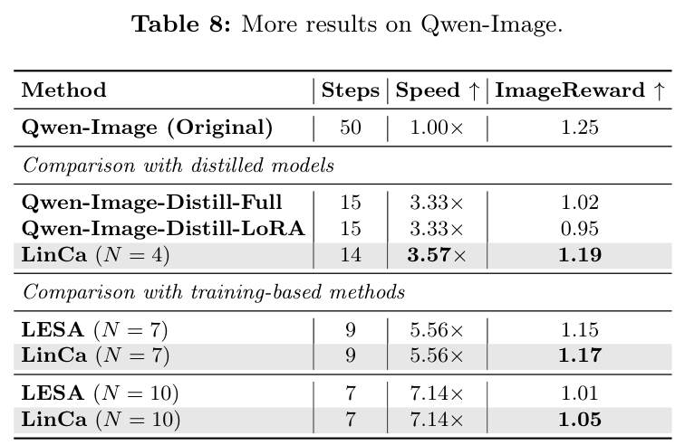
</p>

Even on an 8-step few-step model, LinCa adds another **2.00×** while keeping ImageReward and improving GenEval (0.84 → **0.85**).

<p align="center">
  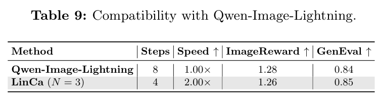
</p>

## Analysis

### Ablation

A trained invertible network beats both an MLP and an untrained invertible net on FLUX and Qwen-Image. Differentiated orders `0+1+2` stay ahead of any single order as `N` grows.

<p align="center">
  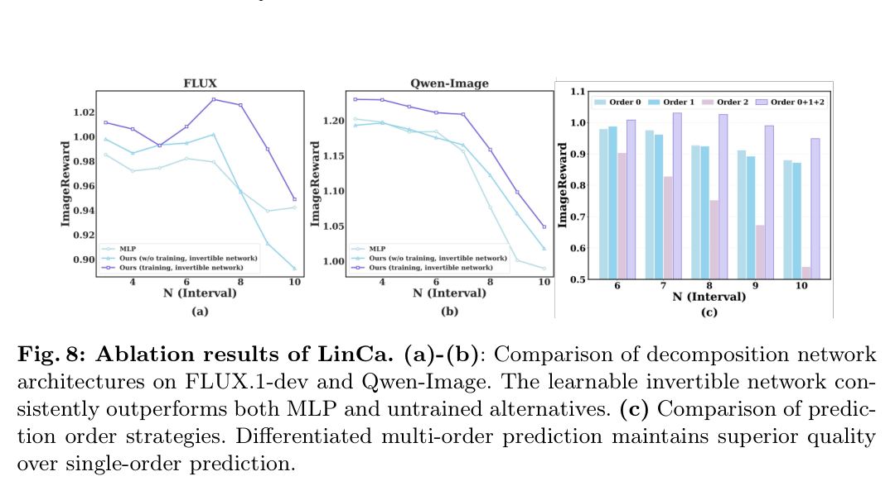
</p>

### Prediction error

LinCa keeps feature MSE low as the cache interval grows. FORA rises steadily; TaylorSeer blows up after `N=6`. This is the root cause of the quality gap at high speedups.

<p align="center">
  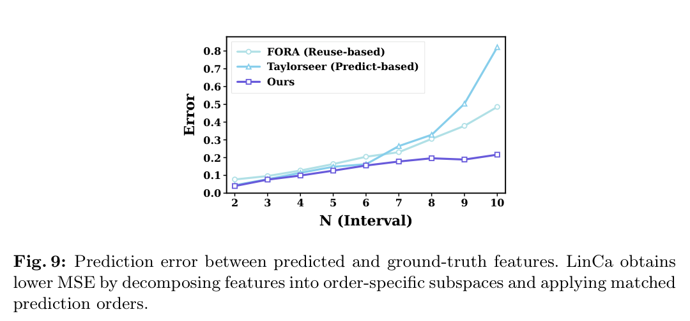
</p>

### Hyperparameters

Paper sweep: timestep segments `S=3`, loss weight `λ=1`, architecture `L=2`, `h=128` are strongest. Extra segments past 3 help little; too-small or too-large `λ` hurts.

<p align="center">
  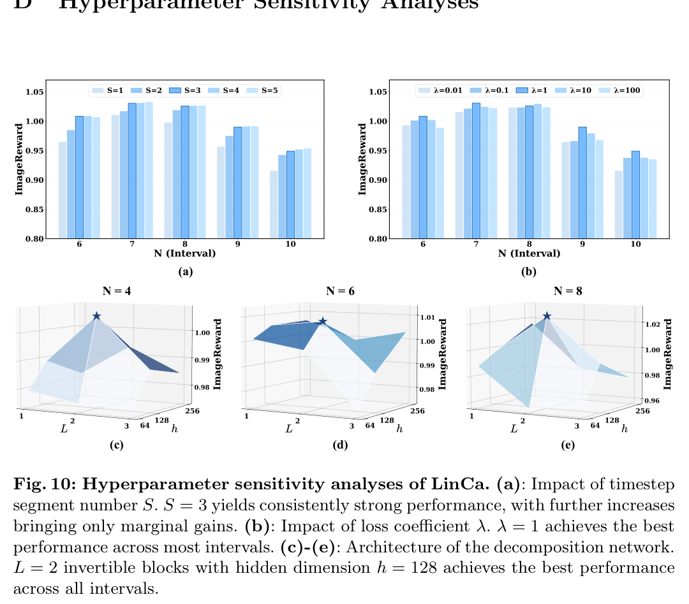
</p>

### High-order predictor

At the same **5.51×**, Hermite is best, ahead of Lagrange / Taylor / Chebyshev / Laguerre. Uniform Taylor on the full feature (TaylorSeer) is weaker even at 4.16×.

| Method | Predictor | FLOPs speedup | ImageReward ↑ | CLIP ↑ |
|---|---|---:|---:|---:|
| TaylorSeer | Taylor | 4.16× | 0.9793 | 32.63 |
| **LinCa** | **Hermite** | 5.51× | **1.0162** | **32.72** |
| LinCa | Lagrange | 5.51× | 1.0144 | 32.60 |
| LinCa | Taylor | 5.51× | 1.0139 | 32.58 |
| LinCa | Chebyshev | 5.51× | 1.0023 | 32.60 |
| LinCa | Laguerre | 5.51× | 0.9264 | 32.50 |

<p align="center">
  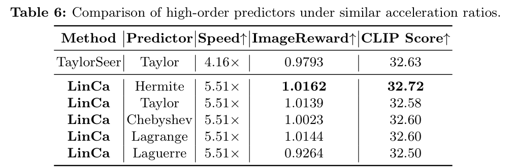
</p>

Released inference scripts keep the **code defaults that match the published checkpoints**. Do not change those defaults just to copy the paper sweep.

## Supported models

| Model | Code | Released weights | Notes |
|---|---|---|---|
| FLUX.1-dev | [`models/flux`](models/flux) | 3-stage predictors | Inference with released weights |
| Qwen-Image | [`models/qwen_image`](models/qwen_image) | two-stage checkpoint | Defaults match the released file |
| Qwen-Image-Edit | [`models/qwen_image_edit`](models/qwen_image_edit) | two-stage checkpoint | Defaults match the released file |
| HunyuanVideo | [`models/hunyuanvideo`](models/hunyuanvideo) | — | Train your own predictor |
| Wan2.1 | [`models/wan2.1`](models/wan2.1) | — | Train your own predictor |

Predictor weights: [QHRQQQ/LinCa](https://huggingface.co/QHRQQQ/LinCa). Backbone weights are **not** included — get them from the official FLUX / Qwen / HunyuanVideo / Wan sources.

## Quick start

Install the official stack for the backbone, then load the LinCa predictor. More flags: [`docs/inference.md`](docs/inference.md).

### Qwen-Image

```bash
huggingface-cli download QHRQQQ/LinCa qwen-image_checkpoint.pt --local-dir ./checkpoints

cd models/qwen_image/qwen_image_linca_two_stage
python sample_learned.py \
  --checkpoint ../../../checkpoints/qwen-image_checkpoint.pt \
  --prompt_file prompts/DrawBench200.txt \
  --output_dir samples/qwen_image
```

### Qwen-Image-Edit

```bash
huggingface-cli download QHRQQQ/LinCa qwen-image-edit_checkpoint.pt --local-dir ./checkpoints

cd models/qwen_image_edit/qwen_image_edit_linca_two_stage
python sample_edit_single.py \
  --checkpoint ../../../checkpoints/qwen-image-edit_checkpoint.pt \
  --image path/to/input.png \
  --prompt "your edit instruction"
```

### FLUX.1-dev

```bash
huggingface-cli download QHRQQQ/LinCa \
  flux/best_predictor_stage0.pt \
  flux/best_predictor_stage1.pt \
  flux/best_predictor_stage2.pt \
  --local-dir ./checkpoints

export FLUX_CHECKPOINT_DIR=/path/to/FLUX.1-dev
cd models/flux
bash run_sample.sh ../../checkpoints/flux 17,17,16
```

`run_sample.sh` expects official FLUX.1-dev files (`flux1-dev.safetensors` + `ae.safetensors`) via `FLUX_CHECKPOINT_DIR` / `FLUX_MODEL` / `FLUX_AE`. Stage splits `17,17,16` match a 50-step schedule.

### HunyuanVideo / Wan2.1

Sampling and training scripts are in each folder. We do not publish trained predictors for these two models.

## Training

Qwen-Image, Qwen-Image-Edit, HunyuanVideo, and Wan2.1 include cache-feature generation and training scripts. Recipe from the paper:

1. Generate intermediate features on a small prompt set (about 100–200 images).
2. Train one invertible predictor per timestep segment.
3. Plug the checkpoint into the sample script.

FLUX training code is not part of this release. See each model README for exact commands.

## Repository layout

```
LinCa/
├── models/flux                 # FLUX inference
├── models/qwen_image           # Qwen-Image train + sample
├── models/qwen_image_edit      # Qwen-Image-Edit train + sample
├── models/hunyuanvideo         # HunyuanVideo train + sample
├── models/wan2.1               # Wan2.1 train + sample
├── docs/                       # extra notes
└── assets/                     # figures and tables from the paper PDF
```

## Citation

```bibtex
@inproceedings{liu2026linca,
  title={LinCa: Accelerating Diffusion Models via Learnable Decomposed Feature Caching},
  author={Liu, Jinshan and Qin, Haoran and Tu, Xiaobing and Liu, Jiacheng and Hu, Jiahui and Yan, Zhengan and Xie, Yukun and Shen, Kerui and Ren, Jinkui and Lin, Yuqi and Zhang, Xiantao and Zhang, Linfeng},
  booktitle={European Conference on Computer Vision (ECCV)},
  year={2026}
}
```

## License

LinCa code is [Apache-2.0](LICENSE). Upstream backbones keep their own licenses; see [NOTICE](NOTICE).

Contact: [qinhaoran68@gmail.com](mailto:qinhaoran68@gmail.com)
